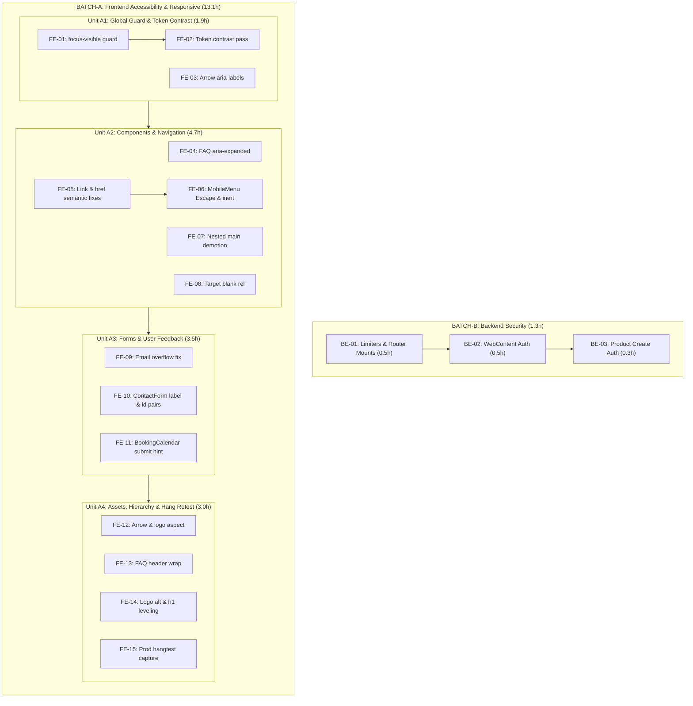

# Implementation Plan & Task Breakdown
**Chain Block 5 of `study/PLAN.md` (:129)**  
**Input:** `study/2026-10-22-priorities.md` · `study/2026-10-22-acceptance-criteria.md` · `study/2026-10-23-herocta-redesign.md`.  
**Ship Rule:** Strict compliance with `study/PLAN.md:6` standing ship pipeline (gates: `npx tsc -b --force` 0/0 · frontend ESLint 140/32 · backend lint 0 · git commit · CI green).

---

## §1 Task Breakdown Table

All 22 `OPEN-CODE` findings mapped to discrete, sequenced implementation tasks. Each estimate includes coding, harness testing, and receipt verification effort — i.e. every row's `Est (h)` is an **all-in total**, and the rows within a stream sum to that stream's total (FE rows: **13.1h**); §3 decomposes those totals into coding vs harness components. *(F-C5 amended 2026-10-26: this sentence previously sat unreconciled with §3's `9.7h coding + 3.0h harness = 12.7h` split — if rows are all-in and harness is 3.0h, coding must be 10.1h, not 9.7h; §3 corrected to match the rows.)*

| Task ID | Finding(s) | Component & File | Description of Changes | Seq # | Depends On | AC Ref | Est (h) | Basis / Analogue | Risk |
|---|---|---|---|---|---|---|---|---|---|
| **FE-01** | REG-21 | `frontend/src/index.css` | Add protective load-bearing warning comment above `*:focus-visible` at line 336 (must stay unlayered). | 1 | None | AC-20 | **0.3h** | Analogue: commit `2adbee7` waiver comment (0.25h) | Low |
| **FE-02** | REG-09, REG-10, REG-11 | `HeroPage.tsx` `Button.tsx` `OperationalStructure.tsx` `BookingPage.tsx` | **Token Contrast Pass:** Swap button fills to `bg-violet-700` (`#6D28D9`), lift Operational violet labels to ≥4.5:1, lift Booking gray labels to ≥4.5:1. | 2 | FE-01 | AC-01, AC-12, AC-18 | **1.2h** | Analogue: commit `2adbee7` sky token sweep (1.0h) | Low |
| **FE-03** | REG-04 | `ClientReviewsSection.tsx` | Add explicit `aria-label="Previous review"` / `"Next review"` on carousel navigation Buttons. | 3 | None | AC-13 | **0.4h** | Analogue: Button prop extension (0.3h) | Low |
| **FE-04** | REG-06 | `FaqSection/Faq.tsx` | Add `aria-expanded` and `aria-controls="faq-panel-${idx}"` to accordion `<button>`; add matching `id` to answer panel. | 4 | None | AC-05 | **0.6h** | Analogue: React state boolean toggle attribute (0.5h) | Low |
| **FE-05** | REG-18 | `Faq.tsx` `HeroPage.tsx` `Header.tsx` `Navigation.tsx` `WhatWeDo.tsx` `ContactUsPage.tsx` `ProductItemCTA.tsx` | Replace raw `<a href="/contact-us">` with `<Link>`; replace programmatic `navigate("/book-a-schedule")` with `<Link to="/book-a-schedule">` (Ruling R-A). | 5 | None | AC-02, AC-07 | **1.5h** | Analogue: Nav link refactor across 6 sites (1.5h) | Low |
| **FE-06** | REG-12 | `MobileMenu.tsx` `Navigation.tsx` | Implement `keydown` Escape handler to close sheet; return focus to hamburger button; apply `inert` to `#root > *:not(#mobile-menu)` or focus trap. | 6 | FE-05 | AC-04 | **2.0h** | Analogue: Modal dialog focus trap implementation (2.0h) | Med |
| **FE-07** | REG-07 | `pages/WhatWeDo.tsx` | Demote inner nested `<main>` tag at line 139 to `
` to maintain single landmark per route. | 7 | None | AC-17 | **0.3h** | Analogue: HTML semantic demotion (0.25h) | Low |
| **FE-08** | REG-17 | `sections/ContactUsSection.tsx` | Add `rel="noopener noreferrer"` to external links with `target="_blank"`. | 8 | None | AC-10 | **0.3h** | Analogue: Link security attribute patch (0.25h) | Low |
| **FE-09** | REG-13 | `sections/ContactUsSection.tsx` | Remove `md:break-normal` on line 123; apply `break-words` on email `
` to prevent card overflow at 768px. | 9 | None | AC-09 | **0.5h** | Analogue: Responsive break-word adjustment (0.5h) | Low |
| **FE-10** | REG-05 | `cards/ContactForm.tsx` | Add explicit `<label for="...">` with visible text and matching `id` attributes to all 8 fields (inputs & selects). | 10 | None | AC-08 | **1.8h** | Analogue: Form validation & accessibility labeling (2.0h) | Low |
| **FE-11** | REG-08 | `BookingCalendar.tsx` | Add visible explanation and `aria-describedby` hint when booking submit button is disabled by `canBook`. | 11 | None | AC-11 | **1.2h** | Analogue: Form state messaging & ARIA alert (1.2h) | Med |
| **FE-12** | REG-14, REG-16 | `ServicesSections.tsx` `ProductSection.tsx` | Correct Services mobile arrow sizing to intrinsic 17:21; apply `aspect-square object-contain` to spinning logo asset. | 12 | None | AC-14, AC-15 | **0.8h** | Analogue: Image aspect ratio containment (0.8h) | Low |
| **FE-13** | REG-15 | `types/components/SuperHeader.tsx` | Adjust FAQ header container width / flex-wrapping at 1024px to prevent text encroachment into column gap. | 13 | None | AC-06 | **0.6h** | Analogue: Responsive column header tuning (0.5h) | Low |
| **FE-14** | REG-19, REG-20 | `ProductSection.tsx` `Homepage.tsx` | Correct logo alt text from "OpSync" to "Opsie" or decorative; re-level section `<h1>` headings to `<h2>`/`<h3>`. | 14 | None | AC-16, AC-19 | **0.8h** | Analogue: Heading outline re-structuring (1.0h) | Low |
| **FE-15** | REG-22 | `hangtest.mjs` | Run production hang test against `npm run build && npm run preview` and generate verified receipt. | 15 | FE-01..14 | AC-21 | **0.8h** | Analogue: Prod build harness profiling (1.0h) | Low |
| **BE-01** | REG-03 | `backend/src/server.ts` | Reorder `appointmentLimiter` before route mount; remove duplicate `productRoute.router` and `ticketRoute.router` mounts. | 1 | None | AC-24 | **0.5h** | Analogue: Express middleware mounting reorder (0.5h) | Med |
| **BE-02** | REG-01 | `backend/src/routes/webContentRoute.ts` | Mount authentication middleware on `update-content` and `publish-content` routes. | 2 | None | AC-22 | **0.5h** | Analogue: Route auth guard addition (0.5h) | Med |
| **BE-03** | REG-02 | `backend/src/routes/productRoute.ts` | Mount authentication middleware on `POST /create` route. | 3 | None | AC-23 | **0.3h** | Analogue: Route auth guard addition (0.3h) | Med |

### Deferred / Owner-Blocked Rows (No Estimates Assumed)
- **REG-26 (Footer social & email):** Estimate deferred pending owner input (live social URLs + verified email).
- **REG-27 (Email credentials in `.env`):** Estimate deferred pending owner input (`EMAIL_USER` / `EMAIL_PASS`).
- **REG-28 (AOS completion rule):** Parked — 0 hours.

---

## §2 Execution Units (Say-the-Word Ship Batches)

---

## §3 Effort Totals & Confidence Assessment

### Total Effort Arithmetic

| Execution Stream | Tasks | Estimated Coding Effort | Harness & Verification | Total Estimated Effort |
|---|---|---|---|---|
| **BATCH-A (Frontend)** | 15 tasks (FE-01..15) | 10.1h *(F-C5 corrected 2026-10-26: was 9.7h — FE rows are all-in and sum 13.1h; minus the 3.0h harness column = 10.1h coding)* | 3.0h | **13.1h** *(F-C5: was 12.7h — matches FE row sum)* |
| **BATCH-B (Backend)** | 3 tasks (BE-01..03) | 0.8h | 0.5h | **1.3h** |
| **Total Shippable Code** | **18 tasks** | **10.9h** *(F-C5: was 10.5h)* | **3.5h** | **14.4h** *(F-C5: was 14.0h — 13.1 + 1.3)* |

**Arithmetic note (F-C5, added 2026-10-26):** FE rows sum **13.1h** (0.3+1.2+0.4+0.6+1.5+2.0+0.3+0.3+0.5+1.8+1.2+0.8+0.6+0.8+0.8) — the pre-correction §3 showed 12.7h (A3 label 3.0 vs rows 3.5, A4 label 3.1 vs rows 3.0); the mermaid unit labels and BATCH-A/Total figures above now match the rows.

**Cross-reference (F-C5, added 2026-10-26):** `study/2026-10-22-priorities.md` L73 states **~11.9h** "Estimated Total Coding Effort" for the same 19 FE rows; this doc states **10.1h coding + 3.0h harness = 13.1h**. The two are not expected to match: priorities sums **effort-band midpoints** (Quick/Mod/Long bands per row), while this doc uses **per-task basis statements** (analogue-derived per task) plus a separate harness column — see the matching note on the priorities side.

### Confidence Assessment
1. **Token Change Ripple (High Confidence):**  
   Replacing `#8B5CF6` with `#6D28D9` (`bg-violet-700`) for text-bearing buttons resolves contrast across 11 failing sites in one sweep. Visual identity is preserved because accents, borders, and display headers retain violet-500/600.
2. **Focus Cascade (High Confidence):**  
   Adopting an unlayered element-scoped rule for the Hero CTA (Ruling R-B) guarantees cascade victory without risking side-effects to `index.css:336`.
3. **Mobile Menu Inert Trap (Medium Confidence):**  
   Implementing `inert` polyfill or standard attribute requires testing across mobile viewports to ensure background scrolling and click events are completely blocked while the sheet is open.
4. **Pass-B Re-run Risk (Low Risk):**  
   Harness scripts (`verify-register.mjs`, `hangtest.mjs`, tab/contrast scripts) are already verified and run cleanly in the local environment.
